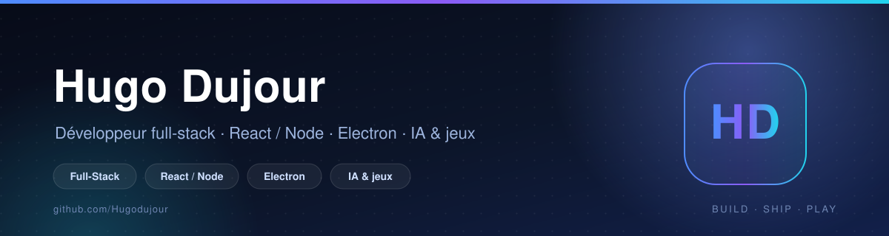

<!--
  README de profil GitHub · @Hugodujour
  Tous les liens pointent vers le profil GitHub. Aucune donnée de contact externe.
-->

<div align="center">
  
</div>

<h3 align="center">Je construis des applis web, des outils desktop et des jeux.</h3>

<p align="center">
  <a href="https://github.com/Hugodujour"></a>
  <a href="https://github.com/Hugodujour?tab=repositories"></a>
  <a href="https://github.com/Hugodujour"></a>
</p>

---

## <samp>&gt; whoami</samp>

Développeur **full-stack** basé en France. J'aime les projets menés de bout en bout : le modèle de données, l'API, l'interface, le déploiement — et quand c'est possible, une bonne dose de fun.

Au travail, je développe en **Java / Angular** avec **PostgreSQL**. À côté, je bricole du React, du Node/NestJS et des jeux.

```ts
const hugo = {
  role: "Développeur full-stack",
  pro: ["Java", "Angular", "PostgreSQL"],
  perso: ["TypeScript", "React", "Node.js", "NestJS", "Electron"],
  aime: ["UI soignée", "game dev", "projets qui racontent quelque chose"],
  enCeMoment: "apps React/NestJS + expérimentations autour des agents IA",
};
```

-  Apps React / NestJS et expérimentations autour des agents IA.
-  Java, Angular et PostgreSQL sur des applications métier.
-  Jeux web, Electron et un peu de romhacking.
-  Le plus simple : [github.com/Hugodujour](https://github.com/Hugodujour), en issue ou en PR.

---

## <samp>&gt; stack</samp>

**Front-end**


**Back-end & données**


**Desktop, jeux & outils**


---

## <samp>&gt; projets phares</samp>

| Projet | Ce que c'est | Stack | Démo |
| :-- | :-- | :-- | :--: |
| **[Lootopia](https://github.com/Hugodujour/Lootopia-front)** | Chasse au trésor géolocalisée : carte interactive, fiches trésors, déclaration de trouvailles | React · Vite · Tailwind · Leaflet | [Live](https://lootopia-front.vercel.app) |
| **[Bouleto Fishing](https://github.com/Hugodujour/renforcement_backend)** | API d'un jeu de pêche : authentification, moteur de jeu, données de test | NestJS · TypeORM · SQLite | — |
| **[Pokémon Pomodoro](https://github.com/Hugodujour/pokemon-pomodoro)** | Widget desktop « always on top » : un timer Pomodoro qui fait évoluer un idle game Pokémon | Electron · React · TypeScript · Drizzle | — |
| **[Chronique d'une IA](https://github.com/Hugodujour/IAdventure)** | Aventure narrative générée par IA, jouable directement dans le navigateur | HTML · CSS · JavaScript | [Live](https://hugodujour.github.io/IAdventure/) |
| **[Valentino Quiz](https://github.com/Hugodujour/valentino-qcm)** | Application de révision type QCM : chrono, scores, progression sauvegardée | HTML · Tailwind · JavaScript | [Live](https://hugodujour.github.io/valentino-qcm/) |
| **[Labo Clicker](https://github.com/Hugodujour/labo-clicker)** | Idle game parodique sur la vie de labo, avec confettis et anecdotes IA | React · Vite · JavaScript | [Live](https://labo-clicker.vercel.app) |
| **[LC Blog](https://github.com/Hugodujour/lcblog)** | API REST de blog (CRUD d'articles) + front-end associé | Node.js · Express · REST | [API](https://lcblog-production.up.railway.app/api/articles) |
| **[Pokémoules](https://github.com/Hugodujour/Pokemoules)** | Romhack de Pokémon Rouge (GBC) : graphismes retravaillés, gameplay intact | Game Boy Color · Romhacking | — |

<details>
<summary><b>Quelques autres projets</b></summary>

<br />

- **[Labo Matter](https://github.com/Hugodujour/labo-matter)** — prototype de jeu 2D avec moteur physique maison sur Matter.js ([démo](https://hugodujour.github.io/labo-matter/)).
- **[lcblog-front](https://github.com/Hugodujour/lcblog-front)** — interface du blog LC Blog, connectée à l'API Node.
- **[Le Blog](https://github.com/Hugodujour/Blog)** — premiers pas full-stack : Node, Express et vues côté serveur.

</details>

---

## <samp>&gt; github en chiffres</samp>

<p align="center">
  
  
</p>

<p align="center">
  
</p>

<p align="center">
  
</p>

<p align="center">
  <picture>
    <source media="(prefers-color-scheme: dark)" srcset="https://raw.githubusercontent.com/Hugodujour/Hugodujour/output/github-snake-dark.svg" />
    <source media="(prefers-color-scheme: light)" srcset="https://raw.githubusercontent.com/Hugodujour/Hugodujour/output/github-snake.svg" />
    
  </picture>
</p>

---

## <samp>&gt; english</samp>

<details>
<summary><b>Read this profile in English</b></summary>

<br />

I'm a **full-stack developer** based in France. I like shipping projects end to end — data model, API, UI, deployment — and adding a healthy dose of fun whenever I can.

At work I build business applications in **Java / Angular** with **PostgreSQL**. On my own time I play with React, Node/NestJS and games.

From NestJS back-ends to Electron widgets and browser games, my goal is always the same: build things that are **usable, clean and pleasant to interact with**.

**Selected work**

- **[Lootopia](https://github.com/Hugodujour/Lootopia-front)** — geolocated treasure hunt (React, Vite, Tailwind, Leaflet).
- **[Bouleto Fishing](https://github.com/Hugodujour/renforcement_backend)** — fishing game API with auth and game engine (NestJS, TypeORM, SQLite).
- **[Pokémon Pomodoro](https://github.com/Hugodujour/pokemon-pomodoro)** — always-on-top Electron widget pairing a Pomodoro timer with a Pokémon idle game.
- **[Chronique d'une IA](https://github.com/Hugodujour/IAdventure)** — AI-generated narrative adventure playable in the browser.
- **[Valentino Quiz](https://github.com/Hugodujour/valentino-qcm)** — quiz app for exam revision with timer, scores and saved progress.
- **[Labo Clicker](https://github.com/Hugodujour/labo-clicker)** — parody idle game about lab life (React, Vite).

Feel free to reach out on GitHub: [@Hugodujour](https://github.com/Hugodujour)

</details>

<br />

<p align="center">
  <i>« Build · Ship · Play »</i><br />
  <sub>Merci de votre visite — et si un projet vous parle, les issues et les PR sont les bienvenues.</sub>
</p>
